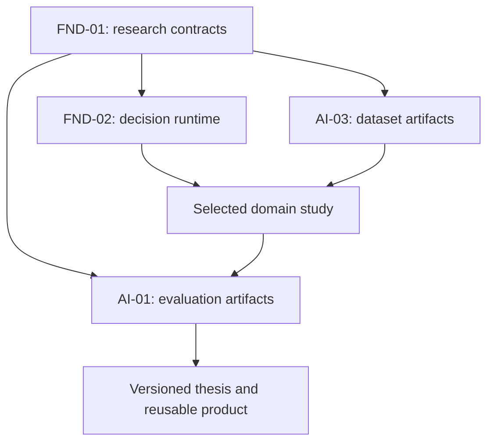

# Portfolio architecture

## 1. Design decision

Use **20 independently versioned repositories**: 18 research products, one portable contract package, and one execution runtime. This is a proposed end-state boundary map. Start by implementing one complete study and only the shared functionality it actually needs. Creating 20 empty repositories before a baseline works would add coordination cost without research evidence.

Each research repository owns a coherent question, model or dataset, evaluation method, and reusable output. Split projects when their experimental unit, validation evidence, release cadence, or independent user differs. Keep tightly coupled calculations inside one project until there is a real external consumer. There is no fixed limit on artifact reuse, but there is a strict distinction between cross-use and cyclic software dependencies.

The [source page](https://app.notion.com/p/402a1ee8bd068049accae3dcf68095ae) requests a repository per thesis/project. The exact decomposition below, including two enabling repositories, is an architectural proposal.

## 2. Repository boundaries and independent value

Commercial opportunities in this table are hypotheses to test with users. The independently useful output is the acceptance boundary; willingness to pay is not established.

| ID | Proposed repository | Owned output and possible independent user | Important cross-use |
|---|---|---|---|
| FND-01 | `research-contracts` | Versioned schemas, fixture validator, evidence manifests; research engineers integrating results | Every project exchanges typed artifacts |
| FND-02 | `decision-runtime` | Auditable model/harness executor; teams comparing decision policies | EN-03, AE-04, AI-01 through AI-05 |
| EN-01 | `solar-capture` | Site/module optical-to-yield trade-space; PV designers and researchers | EN-03 consumes generation scenarios; EN-02 sizes storage |
| EN-02 | `storage-density` | Usable-energy, mass, volume, degradation trade-space; storage and aircraft designers | EN-03, AE-01, AE-02, AE-03 |
| EN-03 | `energy-orchestration` | Feasible dispatch benchmark and policy comparison; microgrid researchers | EN-01/02/04/05 plus runtime and AI evaluation |
| EN-04 | `thermal-efficiency` | Heating/cooling/process-heat models and controller benchmark; building/process engineers | EN-05 produces flexibility offers; EN-03 consumes them |
| EN-05 | `demand-flexibility` | Dispatchable demand envelopes with explicit rebound, service constraints, and uncertainty; aggregators | EN-03 dispatches, EN-04 validates thermal consequences |
| AE-01 | `sensing-aircraft` | Mission-constrained lightweight sensing aircraft design space; civil survey teams | EN-02, AE-03, AE-04, AE-06 |
| AE-02 | `civilian-air-taxi` | Structural/mission trade-space with architecture decision; early aircraft designers | EN-02, AE-03, AE-05, AE-06, AE-07 |
| AE-03 | `propulsion-architectures` | Comparable propulsion-system sizing and mission energy accounting; design teams | EN-02, AE-01/02/05/08 |
| AE-04 | `drone-coordination` | Reproducible civilian fleet coordination benchmark; robotics researchers | AE-01 capabilities, AE-06 scenarios, FND-02, AI-01 |
| AE-05 | `propulsion-durability` | Degradation models and bounded operating-envelope evidence; reliability engineers | AE-03 loads, AE-06 tests, AE-07 observations |
| AE-06 | `coupled-flight-validation` | Credibility-oriented coupled-systems test suite; simulation and integration teams | AE-01 through AE-05; AE-08 scenario artifacts |
| AE-07 | `reflight-inspection` | Inspection triage and maintenance evidence workflow; civil operators | AE-05 degradation, AI-02 uncertainty, AI-03 labeled data |
| AE-08 | `propellant-management` | Bounded feed/pressure/slosh/restart simulation benchmark; propulsion researchers | AE-03 fluid architectures; AE-06 validation |
| AI-01 | `evaluation-lab` | Paired, reproducible evaluation reports with cost/quality/failure analysis; AI teams | Evaluates runtime traces and domain outcomes |
| AI-02 | `factuality-uncertainty` | Supported-claim and calibrated-abstention evaluation; knowledge-system teams | AI-04 judge audit, AI-05 retrieval, AE-07 evidence triage |
| AI-03 | `data-feedback` | Licensed, deduplicated, split-safe data and feedback pipelines; dataset teams | Supplies immutable datasets to all studies |
| AI-04 | `objectives-oversight` | Auditable objective/judge/oversight comparisons; teams operating decision systems | AI-01, AI-02; EN-03/AE-04 escalation research |
| AI-05 | `context-memory` | Permission-aware, temporal memory benchmark and reference component; agent teams | AI-02 evidence retrieval, FND-02 memory-enabled arms |

## 3. Dependency rules

**Build dependencies form a directed acyclic graph.** FND-01 contains small schema packages and fixtures. FND-02 may import a released FND-01 package. Domain and AI projects depend on a released FND-01 contract version or compatible vendored schemas. Experimental arms may use FND-02 for model execution, while offline consumers and independently implemented adapters can exchange the same contracts without importing it. A project can always ingest a compatible file without importing the producing repository.

**Research exchanges can be cyclic across versions.** For example, storage-density v0.1 informs aircraft sizing v0.1, which emits new mission loads for storage-density v0.2. That is an iteration between immutable releases, not two packages importing one another. Every run records exact producer version, artifact digest, and schema version. Never resolve an input as an unversioned “latest” during a run.

**A baseline must run independently.** Each project ships or specifies a small, redistributable synthetic/reference fixture. A consumer can validate its logic before a sibling project has produced real data. Synthetic fixtures cannot support empirical performance or real-world reliability claims.

**No shared operational service is mandatory.** File-based artifacts are the initial interchange. A database, object store, hosted runtime, dashboard, or distributed scheduler can be added when scale justifies it. Common contracts must not impose one simulation engine, cloud vendor, model provider, licensing model, or organization.

## 4. Architectural layers

Arrows show a selected study's artifact flow, not the entire import graph. The detailed edge table is `planning/dependencies.csv`. It distinguishes schema compatibility, optional execution, artifact exchange, and measurement feedback. Static project IDs are used instead of invented repository URLs.

## 5. Three useful integration paths

### Energy path

EN-01 exports site-specific generation series and uncertainty. EN-02 exports usable storage capacity, power limits, efficiency surfaces, and degradation parameters. EN-04 exports thermal state and admissible setpoints. EN-05 turns admissible flexibility into time-indexed offers with deadlines and rebound. EN-03 compares feasible controllers against the same realizations and information set. FND-02 runs only the chosen model/harness arms; AI-01 reports domain-scored outcomes. AI-05 may supply permitted history, but its memory is frozen or reset according to the experimental condition.

The research question is whether a controller improves a stated objective under constraints. A model's fluent rationale does not establish energy savings, feasibility, or safe control.

### Civil sensing aircraft path

AE-01 defines a sensing mission and proposes a design. EN-02 and AE-03 supply mass/energy/power constraints. AE-04 consumes the resulting vehicle capability envelope for multi-aircraft missions. AE-06 tests the coupled models under disturbances, sensor faults, and timing failures. AE-05 and AE-07 investigate reliability and inspection with evidence from the appropriate technology; simulated turbofan degradation does not establish electric-motor lifetime.

The initial useful result can be an infeasible mission/design region with documented reasons. A physically invalid lightweight design is not a successful optimization.

### Trustworthy decision-system path

AI-03 produces split-safe, rights-documented data. AI-05 manages permitted evidence and memory. FND-02 runs a frozen model/harness configuration. AI-02 checks claim support and uncertainty. AI-04 tests objective design and oversight policies. AI-01 measures outcomes with independent evaluators and audit samples. Corrections become a new dataset version; the held-out test set is never silently recycled into training.

## 6. Common information architecture

Each repository should contain a specification, protocol, source register, data manifest, executable baseline, experiment configs, validation tests, result cards, and thesis report. The package's repository template provides a proposed layout. Language and numerical stack are chosen by the problem; Python is a convenient candidate for much of the research but is not a mandatory technology commitment.

A release exports one or more contracts: artifact, dataset, experiment, result, decision request/response, or trace event. Domain payloads extend the artifact envelope with their own versioned schemas. Numerical arrays remain in appropriate data files referenced by hashes rather than being duplicated inside every envelope. Large source data and secrets do not belong in Git.

## 7. Ownership and release boundaries

Each repository has one accountable maintainer role, one primary experimental unit, and one definition of done. Actual people and organizations remain unassigned. Notion can retain intent and decisions; GitHub can own implementation once repositories exist. The downloadable specs are a reviewable snapshot, not a change to either canonical system.

Release contract changes separately from new studies. Additive optional fields can use a minor schema release if compatibility fixtures prove old consumers still behave correctly. Removed fields, changed units, changed meanings, or tighter validation that rejects previously valid records require an explicit migration. This is a proposed versioning policy, not a claim that a particular semantic-version convention proves scientific equivalence.

## 8. What should not become another repository yet

Do not split every algorithm, prompt, dataset transform, physical submodel, chart, or training stage into a new repository by default. Promote a module when a second independent consumer exists or when the module has a distinct research question and release/validation boundary. For example, separate motor thermal simulation from propulsion-durability only if it becomes an independently maintained physical solver; otherwise maintain it as a component with a clear interface.

The architecture supports unlimited depth of reuse without requiring unlimited infrastructure at the beginning. The first implementation should prove that two unrelated studies can exchange well-typed artifacts and produce reproducible reports.
